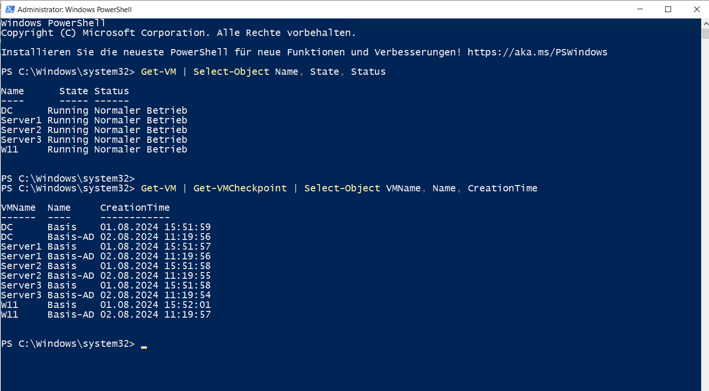
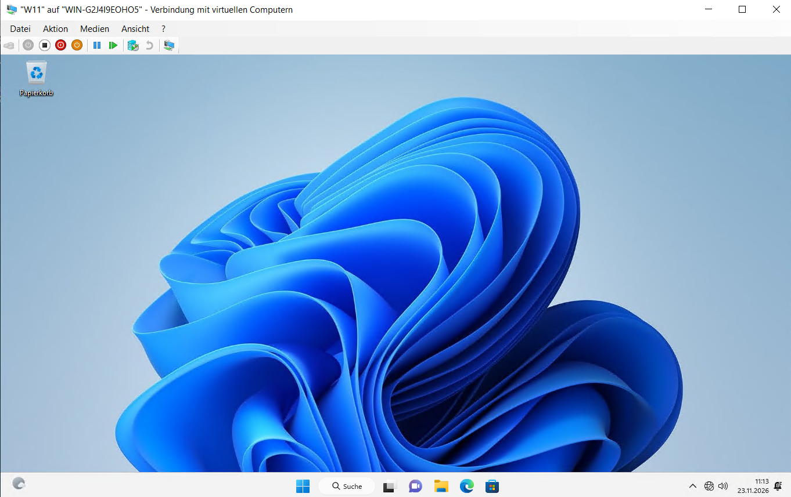

# VM-Grundkonfiguration und Windows-11-Installation

## Ausgangszustand wiederherstellen

- VM `W11` aus Hyper-V entfernt und `H:\VM\W11` gelöscht.
- Prüfpunkt `Basis` auf `DC`, `Server1`, `Server2` und `Server3` angewendet.
- Alle vier Server gestartet.
- Prüfpunkte `Basis-AD` entfernt.



## Windows 11 automatisiert installieren

- Installationsmedium: `Win11_GERMAN_22H2_mit_autounattend.iso`
- Installationsmethode: Unattended Setup mit `autounattend.xml`
- VM: `W11`, Generation 2, 4 GB RAM, 2 vCPUs, Switch `Privat`
- Virtuelle Festplatte: `H:\VM\W11\W11.vhdx`, 127 GB, dynamisch
- Start über virtuelles DVD-Laufwerk; Secure Boot und vTPM für Windows 11 konfiguriert.
- Windows 11 Enterprise installiert; lokales Konto `student` eingerichtet.



## Netzwerkkonfiguration

Auf `W11` in einer administrativen PowerShell ausgeführt:

```powershell
New-NetIPAddress -IPAddress "192.168.1.4" `
    -InterfaceAlias "Ethernet" `
    -PrefixLength 24

Set-DnsClientServerAddress -ServerAddresses "192.168.1.200" `
    -InterfaceAlias "Ethernet"
```

- IPv4-Adresse `192.168.1.4/24` gesetzt.
- DNS-Server `192.168.1.200` konfiguriert.
- Hinweis: Die IP-Ausgabe zeigte zunächst `Tentative` im ActiveStore und `Invalid` im PersistentStore. Ein späterer gültiger Adressstatus wurde nicht dokumentiert.

## Ergebnis

`W11` wurde neu erstellt und Windows 11 installiert. Die Netzwerkbefehle wurden ausgeführt. Eine abschließende Prüfung der IPv4-Gültigkeit liegt nicht vor.
