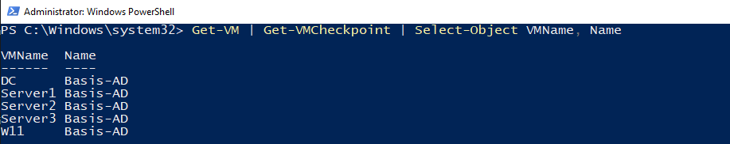

# Active Directory-Grundkonfiguration

## Domäne und Domänencontroller

- Domäne: `gfnlab.test` (`GFNLAB`)
- `DC`: erster Domänencontroller mit DNS, IPv4 `192.168.1.200/24`
- `Server1`: zusätzlicher Domänencontroller, IPv4 `192.168.1.1/24`
- DNS auf Server1: `192.168.1.200`, `192.168.1.1`
- Globaler Katalog auf Server1 aktiviert
- AD-Replikation geprüft: `repadmin /replsummary` mit `0 / 5` Fehlern; `repadmin /showrepl` erfolgreich

## Domänenbeitritt

- `Server2`, `Server3` und `W11` der Domäne `gfnlab.test` hinzugefügt
- Anmeldung mit Domänenkonto durchgeführt
- Verstärkte Sicherheitskonfiguration für IE auf den Servern gemäß Laboranleitung deaktiviert

## Organisationseinheiten und Benutzer

| OU | Benutzer | Anmeldename | Berechtigung |
|---|---|---|---|
| `Arbeit` | Karl Klammer | `kk` | Domänenbenutzer |
| `Administratoren` | Donna Wetter | `dw` | Mitglied von `Domänen-Admins` |

- Kennwortänderung bei der ersten Anmeldung für `kk` deaktiviert
- Anmeldung von `kk` auf `W11` durchgeführt

## SYSVOL-Fix und Prüfpunkte

- Auf `GFN-RLAB` ausgeführt: `C:\ISOs\Tools\sysvol_fix\Geplante_Aufgabe_SysvolFix.ps1`
- Geplante Aufgabe `SysvolFix bei Neustart` auf `DC` angelegt; Ausführung des Fixes beim Neustart nicht separat nachgewiesen
- Prüfpunkt `Basis-AD` für `DC`, `Server1`, `Server2`, `Server3` und `W11` vorhanden
- Prüfpunkt `Basis` nicht mehr vorhanden

## Ergebnis

Domäne eingerichtet, zusätzlicher Domänencontroller repliziert erfolgreich, Domänenbeitritte und Benutzeranlage durchgeführt. Der Prüfpunktzustand `Basis-AD` ist für alle fünf VMs bestätigt.
