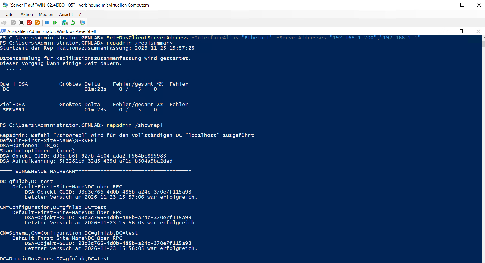
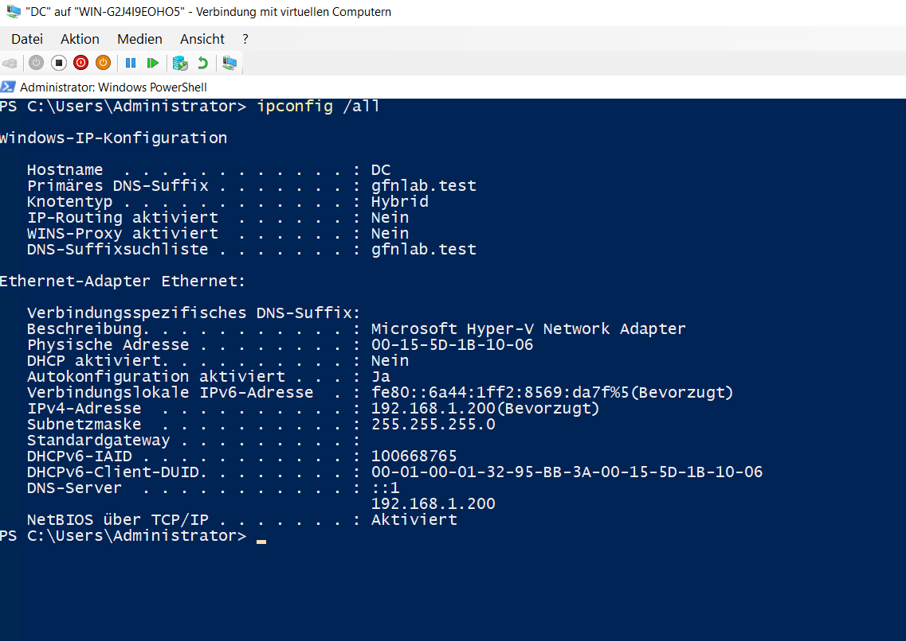

# Active Directory-Grundkonfiguration

## Domäne und Domänencontroller

- Domäne: `gfnlab.test` (`GFNLAB`)
- `DC`: erster Domänencontroller und DNS-Server, `192.168.1.200/24`
- `Server1`: zusätzlicher Domänencontroller, `192.168.1.1/24`
- DNS auf `Server1`: `192.168.1.200`, `192.168.1.1`
- Globaler Katalog auf `Server1` aktiviert
- AD-Replikation: `0 / 5` Fehler; eingehende Replikation von `DC` erfolgreich

## Netzwerkkonfiguration und Domänenbeitritt

- `DC`: Netzwerkprofil `DomainAuthenticated`, DNS `192.168.1.200`
- `Server2`, `Server3` und `W11` der Domäne `gfnlab.test` beigetreten
- Domänenanmeldung auf den Systemen durchgeführt
- Verstärkte Sicherheitskonfiguration für IE auf den Servern gemäß Laboranleitung deaktiviert

## Organisationseinheiten und Benutzer

| Organisationseinheit | Benutzer | Anmeldename | Gruppenzugehörigkeit |
|---|---|---|---|
| `Arbeit` | Karl Klammer | `kk` | Domänenbenutzer |
| `Administratoren` | Donna Wetter | `dw` | `Domänen-Admins` |

- Kennwortänderung bei der ersten Anmeldung für `kk` deaktiviert
- Anmeldung von `kk` auf `W11` durchgeführt

## SYSVOL-Fix und Prüfpunkte

- SYSVOL-Fix auf `GFN-RLAB` gestartet: `C:\ISOs\Tools\sysvol_fix\Geplante_Aufgabe_SysvolFix.ps1`
- Geplante Aufgabe `SysvolFix bei Neustart` auf `DC` angelegt; tatsächliche Ausführung beim Neustart nicht separat bestätigt
- Prüfpunkt `Basis-AD` für `DC`, `Server1`, `Server2`, `Server3` und `W11` vorhanden
- Prüfpunkt `Basis` nicht mehr vorhanden

## Ergebnis

Active Directory eingerichtet, Replikation erfolgreich geprüft und Domänenbeitritte durchgeführt. Der Prüfpunkt `Basis-AD` ist für alle fünf VMs bestätigt.
