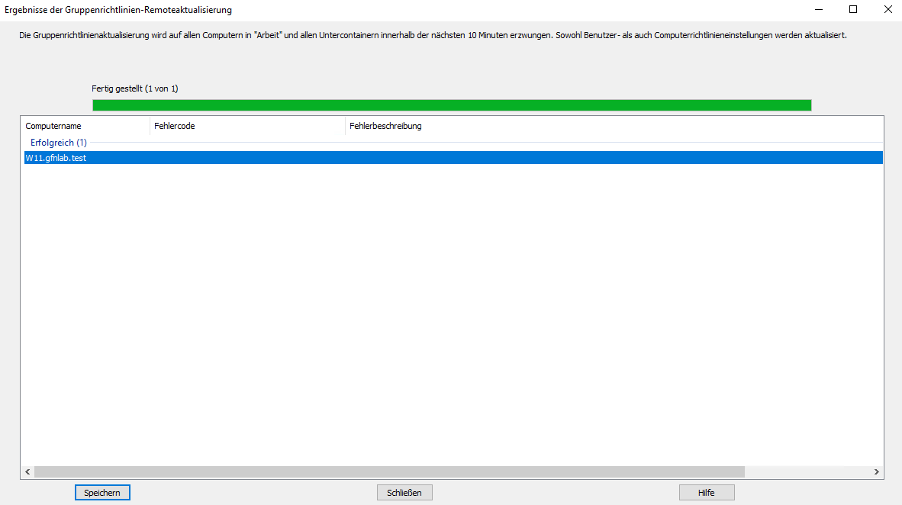
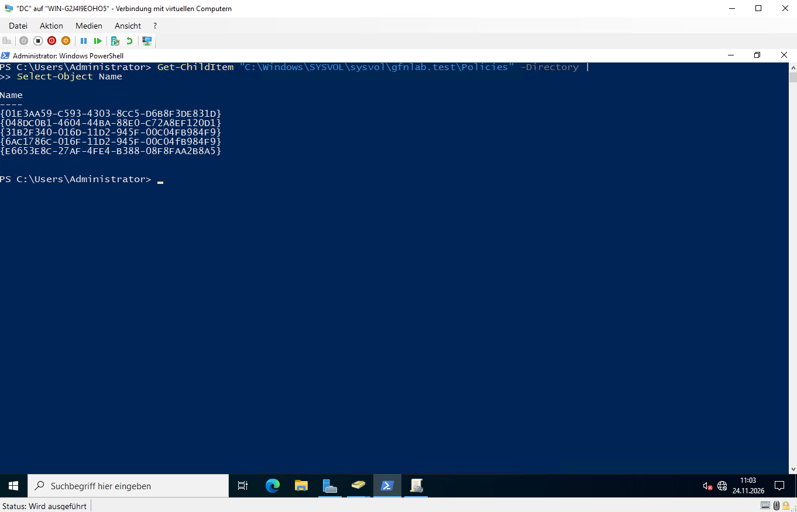

# Active Directory als Verwaltungseinheit

## Gruppenrichtlinien

- `Default Domain Policy` und Kennwortrichtlinien geprüft, unverändert belassen.
- Benutzer- und Computerkonfiguration anhand der OU-Zugehörigkeit unterschieden.
- Client Side Extensions unter `HKLM\SOFTWARE\Microsoft\Windows NT\CurrentVersion\Winlogon\GPExtensions` eingesehen.
- `W11` in die OU `Arbeit` verschoben.

## Remote-Gruppenrichtlinienaktualisierung

- `GPO Berichte Firewall` und `GPO Remoteaktualisierung Firewall` erstellt und mit `gfnlab.test` verknüpft.
- `gpupdate /force` auf `W11` ausgeführt.
- `gpresult /r` bestätigt die Anwendung beider Firewall-GPOs.
- Remoteaktualisierung zunächst mit RPC-Fehler `8007071a`, nach Anwendung der Firewall-GPOs erfolgreich (`1 von 1`).

## GPO-Verknüpfungen und Vererbung

- `GPO-Arbeit` erstellt und mit OU `Arbeit` verknüpft.
- GPO-GUID: `{048DC0B1-4604-44BA-88E0-C72A8EF120D1}`.
- Zugehörigen Ordner in `SYSVOL\sysvol\gfnlab.test\Policies` nachgewiesen.
- `unverknuepftes GPO` erstellt, testweise verknüpft und nur die Verknüpfung entfernt.
- OU `Notebooks` unter `Arbeit` erstellt; Vererbung blockiert.
- GPO `Virenscanner` auf Domänenebene verknüpft und Verknüpfung erzwungen.

## Wiederherstellung

- Prüfpunkt `Basis-AD` für alle fünf VMs wiederhergestellt.
- `DC`, `Server1`, `Server2`, `Server3` und `W11` anschließend gestartet; alle im Zustand `Running`.
- Die nach `Basis-AD` vorgenommenen GPO-Änderungen sind durch die Wiederherstellung nicht mehr im aktuellen VM-Zustand enthalten.
