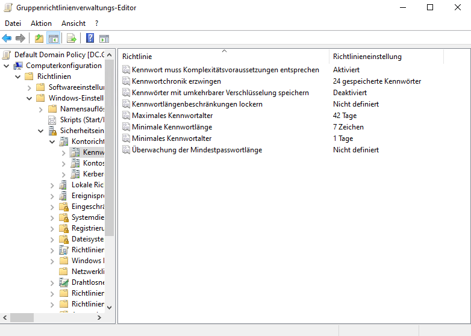
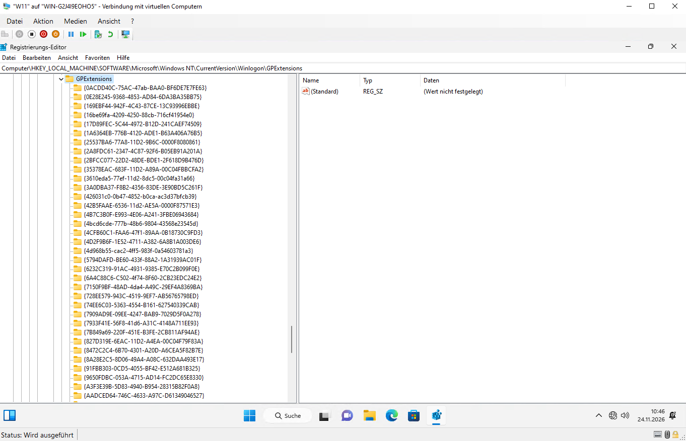
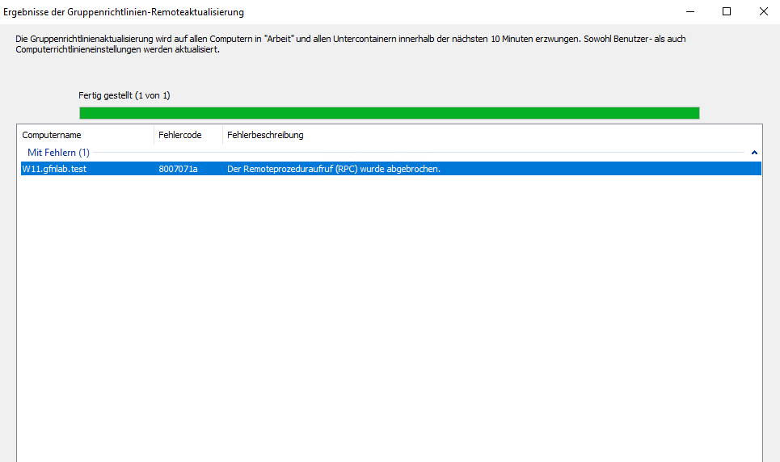

# Active Directory als Verwaltungseinheit

## 1. Default Domain Policy

Auf `DC` wurde die `Default Domain Policy` in der Gruppenrichtlinienverwaltung geprüft. Die Kennwortrichtlinien wurden nur eingesehen und nicht geändert.

| Einstellung | Wert |
|---|---|
| Kennwortkomplexität | Aktiviert |
| Kennwortchronik | 24 Kennwörter |
| Maximales Kennwortalter | 42 Tage |
| Minimale Kennwortlänge | 7 Zeichen |
| Minimales Kennwortalter | 1 Tag |
| Umkehrbare Verschlüsselung | Deaktiviert |
| Kennwortlängenbeschränkungen lockern | Nicht definiert |
| Mindestpasswortlänge überwachen | Nicht definiert |



## 2. GPO-Verarbeitung und Client Side Extensions

- Benutzerkonfiguration richtet sich nach der OU des Benutzers, Computerkonfiguration nach der OU des Computers (ohne Loopbackverarbeitung).
- Auf `W11` die Client Side Extensions im Registrierungs-Editor eingesehen:
  `HKEY_LOCAL_MACHINE\SOFTWARE\Microsoft\Windows NT\CurrentVersion\Winlogon\GPExtensions`
- Keine Registry-Werte verändert.
- Auf `W11` als `GFNLAB\dw` `gpupdate /force` ausgeführt.



## 3. Remoteaktualisierung der Gruppenrichtlinien

1. Computerkonto `W11` aus `Computers` in die OU `Arbeit` verschoben.
2. Gruppenrichtlinienupdate auf der OU `Arbeit` ausgelöst. Ergebnis zunächst: RPC-Fehler `8007071a`.
3. Starter-Gruppenrichtlinienobjekte für Firewallports angelegt bzw. bereitgestellt.
4. `GPO Berichte Firewall` und `GPO Remoteaktualisierung Firewall` aus den entsprechenden Starter-GPOs erstellt und mit `gfnlab.test` verknüpft.
5. Auf `W11` `gpupdate /force` und `gpresult /r` ausgeführt.
6. `gpresult /r` zeigte beide Firewall-GPOs als angewendet. Anschließend war das Remote-Gruppenrichtlinienupdate auf `W11` erfolgreich (`1 von 1`).




## 4. GPO-Erstellung, Verknüpfung und SYSVOL

- `GPO-Arbeit` erstellt und mit OU `Arbeit` verknüpft.
- GUID: `{048DC0B1-4604-44BA-88E0-C72A8EF120D1}`.
- Zugehörigen Ordner unter `C:\Windows\SYSVOL\sysvol\gfnlab.test\Policies` nachgewiesen; insgesamt fünf GPO-Ordner angezeigt.
- `unverknuepftes GPO` erstellt und mit `Arbeit` verknüpft.
- Anschließend nur die Verknüpfung entfernt. Das GPO blieb unter `Gruppenrichtlinienobjekte` bestehen.


## 5. GPO-Vererbung und Erzwingung

- OU `Notebooks` unterhalb von `Arbeit` erstellt.
- Gruppenrichtlinienvererbung für `Notebooks` blockiert.
- GPO `Virenscanner` auf Domänenebene erstellt und verknüpft.
- Verknüpfung von `Virenscanner` auf `Erzwungen` gesetzt, um die Vererbungsblockierung zu übersteuern.

## 6. Wiederherstellung des Laborzustands

Auf `GFN-RLAB` wurde für alle fünf VMs der Prüfpunkt `Basis-AD` wiederhergestellt:

```powershell
Get-VM | Get-VMCheckpoint -Name "Basis-AD" | Restore-VMCheckpoint -Confirm:$false
Get-VM | Where-Object State -eq 'Off' | Start-VM
Get-VM | Select-Object Name, State
```

| VM | Status |
|---|---|
| DC | Running |
| Server1 | Running |
| Server2 | Running |
| Server3 | Running |
| W11 | Running |

**Ergebnis:** Die Übungen zur GPO-Verwaltung wurden durchgeführt und der Ausgangszustand `Basis-AD` wiederhergestellt. Änderungen nach diesem Prüfpunkt sind im aktuellen VM-Zustand nicht mehr vorhanden.
