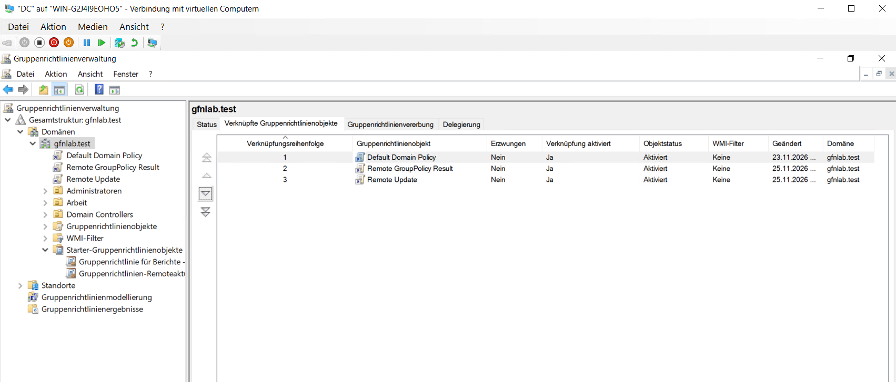
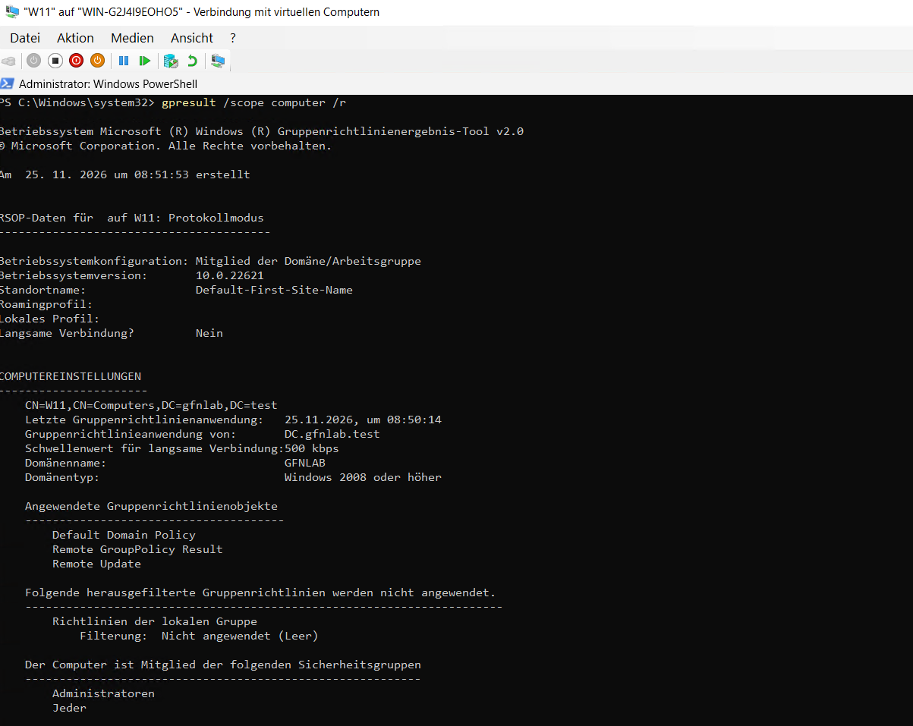
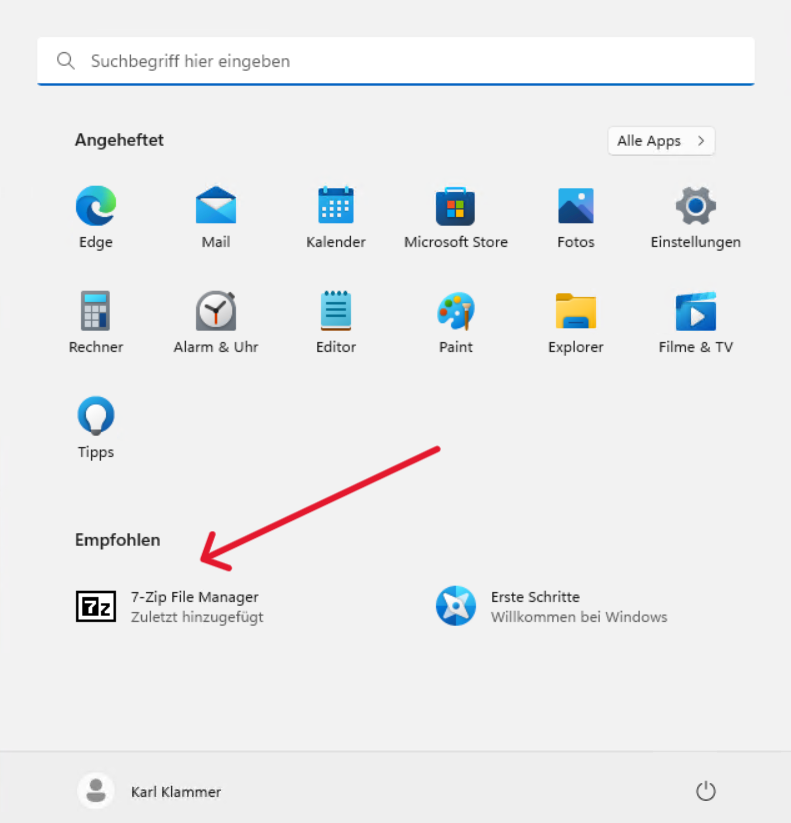

# Gruppenrichtlinien-Grundlagen

## 1. Central Store

- Auf `DC` die administrativen Vorlagen zunächst aus dem lokalen `PolicyDefinitions`-Verzeichnis geprüft.
- Central Store unter `C:\Windows\SYSVOL\domain\Policies\PolicyDefinitions` eingerichtet.
- ADMX- und sprachspezifische ADML-Dateien übernommen.
- Verwendung der zentralen Richtliniendefinitionen im Gruppenrichtlinienverwaltungs-Editor geprüft.
- Inhalte auf `DC` und `Server1` verglichen.

## 2. Starter-GPOs und Firewall-Richtlinien

- Starter-GPOs für Berichte und Gruppenrichtlinien-Remoteaktualisierung bereitgestellt.
- `Remote GroupPolicy Result` und `Remote Update` daraus erstellt.
- Beide GPOs mit der Domäne `gfnlab.test` verknüpft und Einstellungen eingesehen.
- Verknüpfungen aktiviert, nicht erzwungen; Sicherheitsfilterung: `Authentifizierte Benutzer`.

## 3. Richtlinienanwendung auf W11

- `gpupdate /force` auf `W11` ausgeführt.
- Mit `gpresult /r` die Benutzerrichtlinien für `GFNLAB\dw` eingesehen.
- Computerrichtlinien in administrativer PowerShell mit `gpresult /scope computer /r` abgefragt.
- Angewendete Computer-GPOs: `Default Domain Policy`, `Remote GroupPolicy Result`, `Remote Update`.

## 4. Gruppenrichtlinienergebnisse

- Auf `DC` mit dem Gruppenrichtlinienergebnis-Assistenten einen Bericht für `GFNLAB\kk` auf `W11` erstellt.
- Letzte Computer- und Benutzerrichtlinienverarbeitung im Bericht ohne Fehler.
- Richtlinienereignisse eingesehen; ein älterer Eintrag mit Ereignis-ID `1126` war sichtbar.
- HTML-Bericht als `KK.html` gespeichert.

## 5. Softwareverteilung mit GPO

- `W11` in die OU `Arbeit` verschoben.
- Auf `DC` den Ordner `C:\Software` als `\\DC\Software` freigegeben.
- 7-Zip-MSI aus `C:\ISOs\Tools` in die Freigabe kopiert.
- GPO `Softwareverteilung 7-Zip` mit `Arbeit` verknüpft.
- MSI über `Computerkonfiguration > Richtlinien > Softwareeinstellungen > Softwareinstallation` per UNC-Pfad als `Zugewiesen` bereitgestellt.
- Gruppenrichtlinien aktualisiert und `W11` neu gestartet.
- `7-Zip File Manager` im Startmenü unter dem angemeldeten Benutzer Karl Klammer sichtbar.

## 6. Wiederherstellung

Auf `GFN-RLAB` wurde der Prüfpunkt `Basis-AD` für alle VMs wiederhergestellt. Anschließend liefen alle fünf VMs:

| VM | Zustand |
|---|---|
| DC | Running |
| Server1 | Running |
| Server2 | Running |
| Server3 | Running |
| W11 | Running |

**Ergebnis:** Central Store, GPO-Verteilung, Gruppenrichtlinienergebnisse und MSI-Softwareverteilung bearbeitet. Durch die abschließende Wiederherstellung sind die Änderungen dieses Labs nicht mehr im aktuellen VM-Zustand enthalten.
