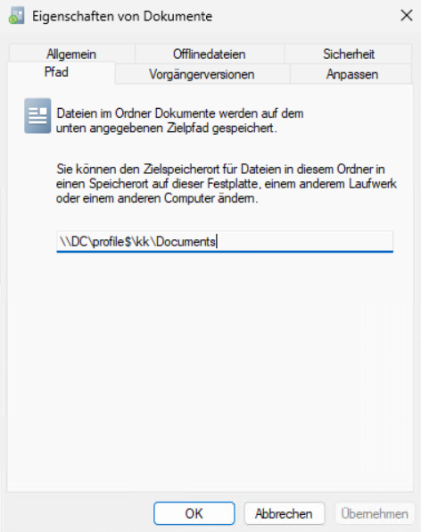
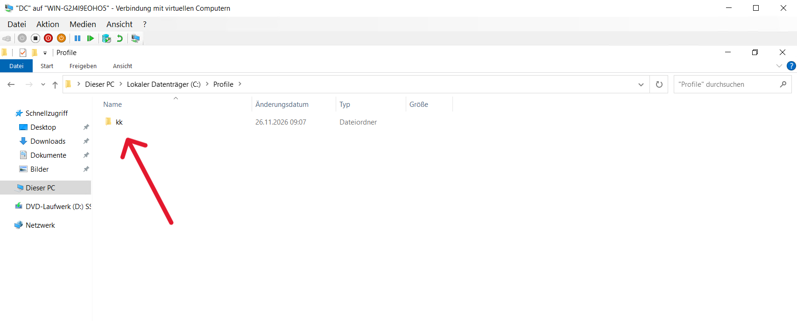

# Ordnerumleitung

## Konfiguration

- GPO `Ordner umleiten` erstellt und mit der OU `Arbeit` verknüpft.
- Ordner `Dokumente` für Benutzer auf die Netzwerkfreigabe `\\DC\Profile$` umgeleitet.
- Auf `DC` den Ordner `C:\Profile` eingerichtet und als `Profile$` freigegeben.
- NTFS-Vererbung deaktiviert und Berechtigungen für `SYSTEM`, `Administratoren`, `ERSTELLER-BESITZER` und `Domänen-Benutzer` angepasst.
- Fehlende SMB-Freigabe mit PowerShell angelegt:

```powershell
New-SmbShare -Name 'Profile$' -Path 'C:\Profile' -FullAccess 'Jeder'
```

## Ergebnis

- Zugriff auf `\\DC\Profile$` mit `GFNLAB\kk` bestätigt.
- GPO `Ordner umleiten` laut `gpresult /r` angewendet.
- Nach `gpupdate /force` und erneuter Anmeldung zeigt `Dokumente` auf `\\DC\profile$\kk\Documents`.
- Benutzerordner `C:\Profile\kk` auf `DC` vorhanden.




