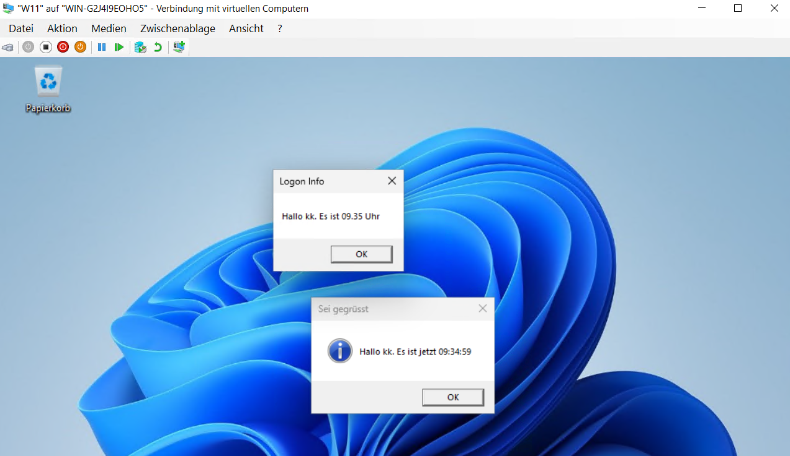
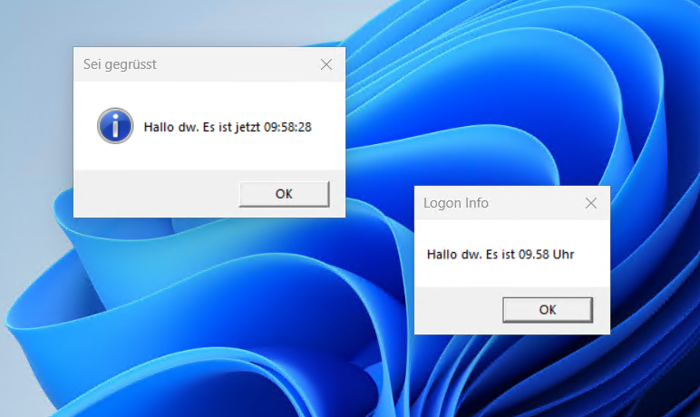
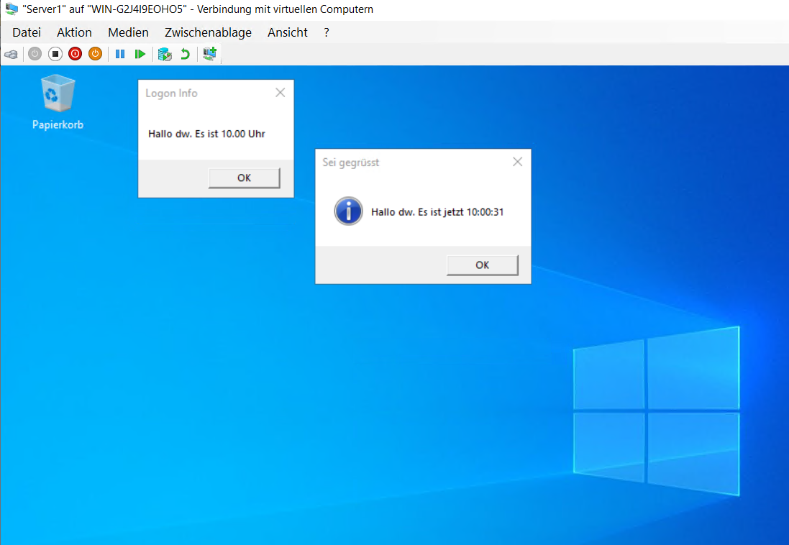
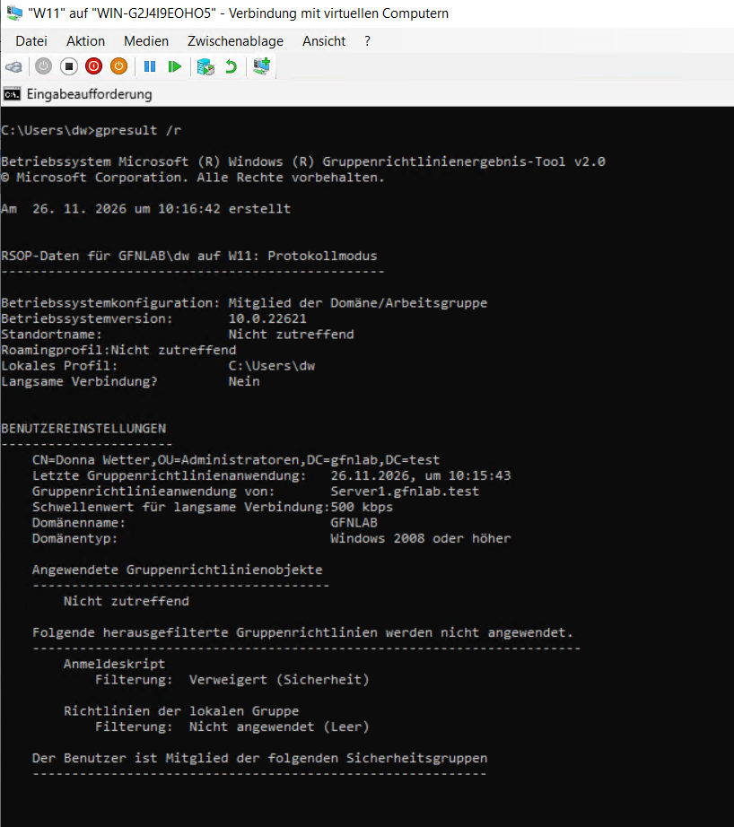

# Anmeldeskripte und GPO-Filterung

## 1. Anmeldeskripte einrichten

- Auf `DC` die Skripte `HalloUser.vbs` und `Hallo.ps1` erstellt.
- GPO `Anmeldeskript` angelegt und mit `gfnlab.test` verknüpft.
- VBScript unter **Benutzerkonfiguration > Richtlinien > Windows-Einstellungen > Skripts > Anmelden** eingetragen; PowerShell-Skript auf der Registerkarte **PowerShell-Skripts**.
- Beide Dateien unter `SYSVOL` im GPO-Verzeichnis `User\Scripts\Logon` abgelegt.
- Anmeldung mit `GFNLAB\kk` auf `W11`: Beide Begrüßungsfenster erschienen.

## 2. Fehlerbehebung

- Obwohl die GPO angewendet wurde, erschienen zunächst keine Meldungen.
- Ursache: `scripts.ini` und `psscripts.ini` enthielten lokale Pfade unter `C:\Users\Administrator\Documents`.
- INI-Dateien gesichert und `0CmdLine` auf `HalloUser.vbs` bzw. `Hallo.ps1` korrigiert.
- Zeichencodierung des VBScript für Windows Script Host angepasst.
- Nach erneuter Anmeldung funktionierten beide Skripte mit korrekt dargestellten Sonderzeichen.



## 3. Vererbungsblockierung und Erzwingen

- Vererbung auf OU `Arbeit` blockiert; `Anmeldeskript` wurde für Karl Klammer nicht mehr angewendet.
- Anmeldung von Donna Wetter (`dw`) auf `W11` und `Server1`: Beide Skripte wurden ausgeführt.
- Domänenverknüpfung von `Anmeldeskript` auf **Erzwungen** gesetzt.
- `gpresult /r` bestätigte die erneute Anwendung bei `GFNLAB\kk` trotz Vererbungsblockierung.
- Anschließend Vererbungsblockierung und Erzwingen wieder aufgehoben.






## 4. WMI-Filter

- WMI-Filter `Nur Clients` erstellt und mit GPO `Anmeldeskript` verknüpft.
- Namespace: `root\CIMv2`

```sql
SELECT * FROM Win32_OperatingSystem WHERE ProductType = 1
```

- Ergebnis: Skripte auf `W11` ausgeführt, auf `Server1` nicht ausgeführt.

## 5. Sicherheitsfilterung

- In **Delegierung > Erweitert** für `Domänen-Admins` die Berechtigung **Gruppenrichtlinie übernehmen** auf **Verweigern** gesetzt.
- Auf `W11` wurde die GPO für `GFNLAB\dw` mit `gpresult /r` als **Verweigert (Sicherheit)** ausgewiesen.
- Ein erneuter Test mit `GFNLAB\kk` nach der Sicherheitsfilterung ist nicht dokumentiert.



## Ergebnis

Anmeldeskripte, GPO-Vererbung, erzwungene Verknüpfung, WMI-Filter und Sicherheitsfilterung konfiguriert und die dokumentierten Ergebnisse geprüft.
