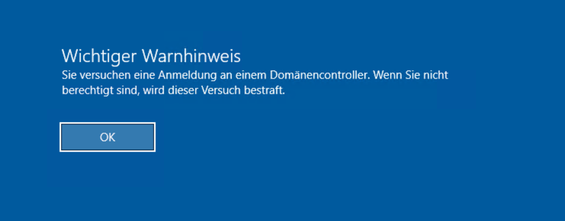

# Sicherheitsvorlagen und Sicherheitsanalyse

## MMC und Vorlagen

- Auf `DC` eine MMC mit den Snap-ins `Sicherheitsvorlagen` und `Sicherheitskonfiguration und -analyse` eingerichtet.
- Vorlagensuchpfad `C:\Windows\security\templates` hinzugefügt.
- Vorlage `DC security` als `Meine DC Sicherheitsvorlage` kopiert.
- Leere `Testvorlage` erstellt.

## Sicherheitsoptionen

In `Meine DC Sicherheitsvorlage` unter **Lokale Richtlinien > Sicherheitsoptionen** konfiguriert:

| Einstellung | Wert |
|---|---|
| Interaktive Anmeldung: Nachrichtentitel | `Wichtiger Warnhinweis` |
| Interaktive Anmeldung: Nachricht | `Sie versuchen eine Anmeldung an einem Domänencontroller. Wenn Sie nicht berechtigt sind, wird dieser Versuch bestraft.` |

Die angepasste Vorlage wurde gespeichert.

## Sicherheitsanalyse

- Sicherheitsdatenbank `DC-Analyse.sdb` erstellt.
- `Meine DC Sicherheitsvorlage.inf` in die Datenbank importiert.
- **Computer jetzt analysieren** ausgeführt, ohne die Vorlage lokal anzuwenden.
- Abweichungen bei Nachricht und Nachrichtentitel in der Analyse festgestellt.
- Sicherheitsvorlage als `DC Sicherheitsvorlage nach Analyse.inf` exportiert.

## Anwendung über Gruppenrichtlinien

- Anmeldung auf `DC` und `Server1` vor dem GPO-Import getestet.
- Exportierte Sicherheitsvorlage in die `Default Domain Controllers Policy` importiert.
- Auf `Server1` `gpupdate /force` ausgeführt und erneut angemeldet.
- Warnmeldung vor der Anmeldung auf `Server1` angezeigt.

## Ergebnis

Die Sicherheitsvorlage wurde analysiert, exportiert und über die Domänencontroller-GPO bereitgestellt. Die Warnmeldung auf `Server1` wurde nach der Richtlinienaktualisierung bestätigt.
