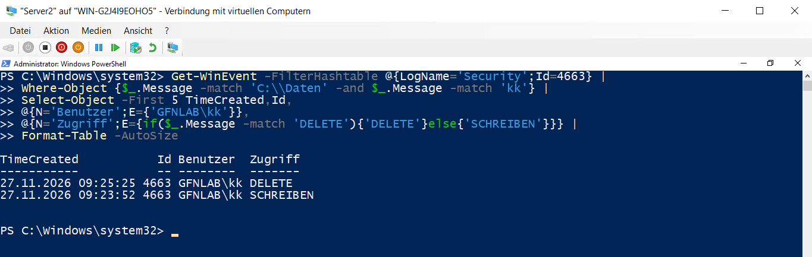

# Dateisystemüberwachung

## Gruppenrichtlinie

Auf `DC` wurde die GPO `Ordnerüberwachung` erstellt und mit `gfnlab.test` verknüpft. Die bestehenden Konto-, Kennwort- und Kerberos-Richtlinien wurden zuvor geprüft und nicht geändert.

Unter **Computerkonfiguration > Richtlinien > Windows-Einstellungen > Sicherheitseinstellungen > Erweiterte Überwachungsrichtlinienkonfiguration** wurden folgende Einstellungen vorgenommen:

| Richtlinie | Konfiguration |
|---|---|
| Objektzugriff > Dateisystem überwachen | Erfolg |
| Globale Objektzugriffsüberwachung > Dateisystem | Richtlinieneinstellung definiert |
| Prinzipal | Jeder |
| Überwachungstyp | Erfolgreich |

Überwachte Berechtigungen:

- Dateien erstellen / Daten schreiben
- Ordner erstellen / Daten anfügen
- Unterordner und Dateien löschen
- Löschen

## Test auf Server2

1. Gruppenrichtlinien mit `gpupdate` aktualisiert.
2. Verzeichnis `C:\Daten` erstellt.
3. `Domänen-Benutzer` die NTFS-Berechtigung **Ändern** erteilt.
4. Sicherheitsprotokoll in der Ereignisanzeige für den Labortest geleert.
5. Als `GFNLAB\kk` die Datei `C:\Daten\Neues Textdokument.txt` im Explorer erstellt.
6. Datei anschließend über PowerShell gelöscht.

```powershell
Set-Location C:\Daten
Remove-Item '.\Neues Textdokument.txt'
```

## Überwachungsergebnis

Im Sicherheitsprotokoll von `Server2` wurden Ereignisse mit der **Ereignis-ID 4663** für `GFNLAB\kk` gefunden:

| Zeitpunkt | Prozess | Zugriff |
|---|---|---|
| 27.11.2026 09:23:52 | `explorer.exe` | Daten schreiben (`0x2`) |
| 27.11.2026 09:25:25 | `powershell.exe` | DELETE (`0x10000`) |

**Objekt:** `C:\Daten\Neues Textdokument.txt`



## Ergebnis

Die konfigurierte Überwachung protokollierte den Schreib- und Löschzugriff auf die Testdatei mit Benutzer, Zeitpunkt und Prozess. Beide Ereignisse wurden anhand der Sicherheitsereignisse nachgewiesen.
