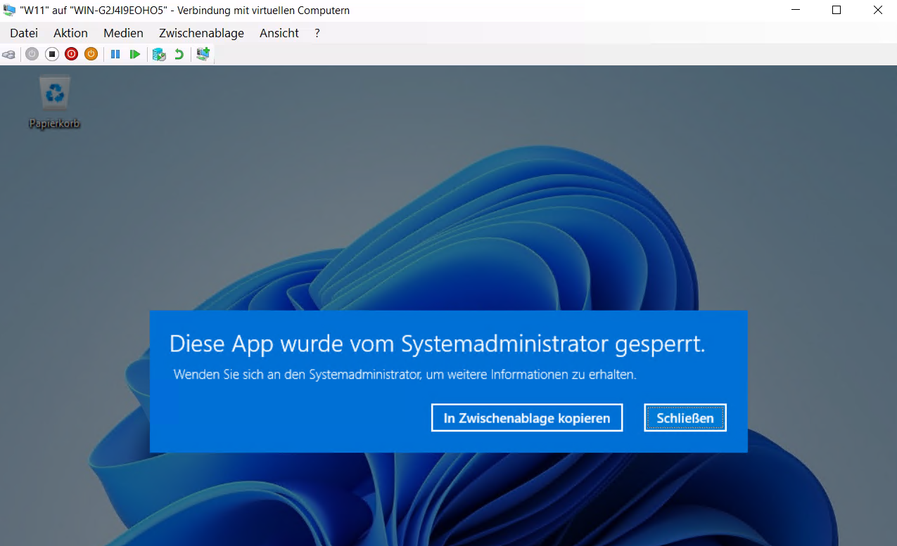

# AppLocker: WordPad sperren

## Gruppenrichtlinie

Auf `DC` wurde die GPO **Kein Wordpad zugelassen** erstellt.

Im Gruppenrichtlinienverwaltungs-Editor wurde folgender Pfad geöffnet:

```text
Computerkonfiguration
└── Richtlinien
    └── Windows-Einstellungen
        └── Sicherheitseinstellungen
            └── Anwendungssteuerungsrichtlinien
                └── AppLocker
```

Für alle vier Regeltypen wurden die **Standardregeln** erstellt:

- Ausführbare Regeln
- Windows Installer-Regeln
- Skriptregeln
- App-Paketregeln

## WordPad-Sperrregel

Unter **Ausführbare Regeln** wurde eine Herausgeberregel eingerichtet:

| Einstellung | Konfiguration |
|---|---|
| Aktion | Verweigern |
| Benutzergruppe | `GFNLAB\Domänen-Benutzer` |
| Bedingung | Herausgeber |
| Referenzdatei | `C:\Program Files\Windows NT\Accessories\wordpad.exe` |
| Geltungsbereich | Versionsunabhängig anhand des Dateinamens |
| Regelname | `Wordpad ist nicht zugelassen` |

## Regelerzwingung

| Regeltyp | Einstellung |
|---|---|
| Ausführbare Regeln | Regeln erzwingen |
| Windows Installer-Regeln | Nur überwachen |
| Skriptregeln | Nur überwachen |
| App-Paketregeln | Nur überwachen |

Die GPO wurde mit der Domäne `gfnlab.test` verknüpft.

## Funktionstest auf W11

1. Anmeldung als `GFNLAB\kk`.
2. Gruppenrichtlinien mit `gpupdate /force` aktualisiert.
3. `W11` neu gestartet und erneut als `GFNLAB\kk` angemeldet.
4. Start von `wordpad.exe` versucht.

**Ergebnis:** Der Start wurde durch AppLocker verhindert. Windows zeigte die Meldung:

> Diese App wurde vom Systemadministrator gesperrt.



## Wiederherstellung

Auf `GFN-RLAB` wurde für alle fünf VMs der Prüfpunkt `Basis-AD` wiederhergestellt:

```powershell
Get-VM | Restore-VMCheckpoint -Name "Basis-AD" -Confirm:$false
```

Die AppLocker-Konfiguration des Tests ist nach der Wiederherstellung nicht mehr Bestandteil des aktuellen VM-Zustands.
