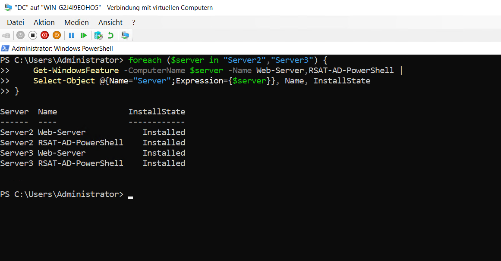
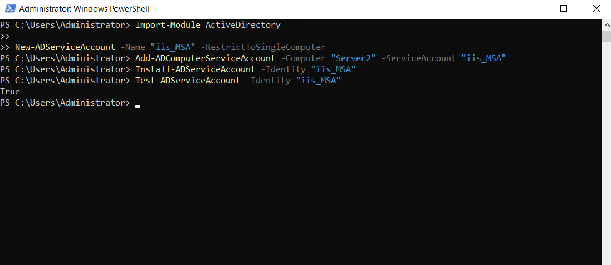
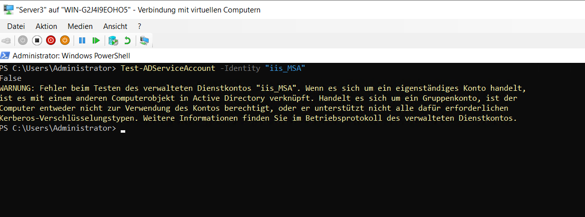

# Eigenständiges verwaltetes Dienstkonto (sMSA)

## Ziel
Ein sMSA für den IIS-Anwendungspool auf `Server2` einrichten und die Beschränkung auf einen Computer nachweisen.

## Umgebung
- Domäne: `gfnlab.test`
- Verwaltung: `DC`
- Zielserver: `Server2`, `Server3`
- Dienstkonto: `iis_MSA`

## Durchführung

1. Auf `Server2` und `Server3` die Windows-Features `Web-Server` und `RSAT-AD-PowerShell` installiert.

   

2. Auf `Server2` das sMSA erstellt, dem Computer zugeordnet und installiert:

   ```powershell
   New-ADServiceAccount -Name "iis_MSA" -RestrictToSingleComputer
   Add-ADComputerServiceAccount -Computer "Server2" -ServiceAccount "iis_MSA"
   Install-ADServiceAccount -Identity "iis_MSA"
   Test-ADServiceAccount -Identity "iis_MSA"
   ```

   **Ergebnis:** `True`

   

3. Auf `Server2` im IIS-Manager die Identität von `DefaultAppPool` auf `GFNLAB\iis_MSA$` gesetzt und den Anwendungspool neu gestartet.
4. Auf `Server3` die Verwendung desselben Kontos geprüft:

   ```powershell
   Test-ADServiceAccount -Identity "iis_MSA"
   ```

   **Ergebnis:** `False`, da das sMSA `Server2` zugeordnet ist.

   

5. Die Identität des `DefaultAppPool` auf `Server3` wieder auf `ApplicationPoolIdentity` zurückgesetzt.

## Ergebnis

| Server | Test-ADServiceAccount | Ergebnis |
|---|---|---|
| Server2 | `True` | sMSA verwendbar |
| Server3 | `False` | sMSA nicht zugeordnet |

Das sMSA ist auf einen Computer beschränkt. Ein gesonderter Webanwendungstest wurde nicht durchgeführt.
