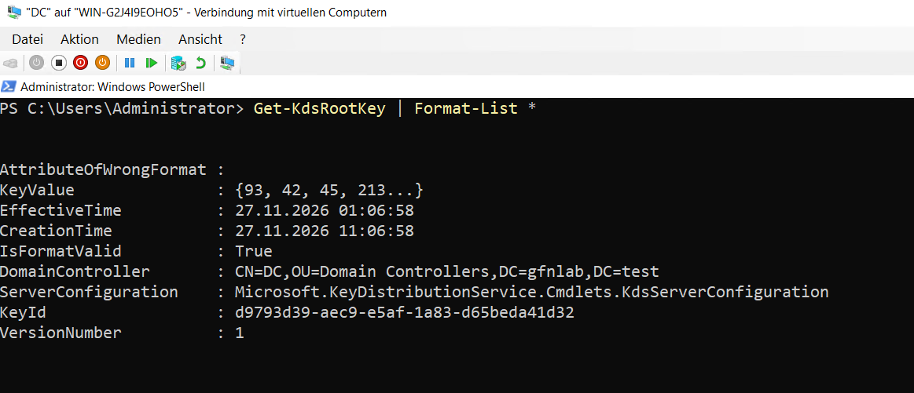

# Gruppenverwaltete Dienstkonten (gMSA)

## Ziel
Ein gemeinsames, durch Active Directory verwaltetes Dienstkonto für die IIS-Anwendungspools auf `Server2` und `Server3` bereitstellen.

## Umgebung
- Domäne: `gfnlab.test`
- Domänencontroller: `DC`
- Anwendungsserver: `Server2`, `Server3`
- Sicherheitsgruppe: `WebServerFarmGruppe`
- Dienstkonto: `iis_gMSA`

## Durchführung

1. In Active Directory die globale Sicherheitsgruppe `WebServerFarmGruppe` erstellt und die Computerkonten `Server2$` und `Server3$` hinzugefügt.
2. Beide Server neu gestartet, um die Gruppenmitgliedschaft zu aktualisieren.
3. Auf `DC` einen KDS-Root-Schlüssel für die Laborumgebung angelegt:

   ```powershell
   Add-KdsRootKey -EffectiveTime ((Get-Date).AddHours(-10))
   ```

   Der Schlüssel wurde anschließend mit `Get-KdsRootKey | Format-List *` nachgewiesen.

   

4. Das bereits vorhandene gMSA `iis_gMSA` geprüft. Die Konfiguration entsprach den Vorgaben:

   ```text
   Name: iis_gMSA
   DNSHostName: WebFarmDienst.gfnlab.test
   PrincipalsAllowedToRetrieveManagedPassword: WebServerFarmGruppe
   ```

5. Das Konto auf beiden Servern installiert und getestet:

   ```powershell
   Install-ADServiceAccount -Identity "iis_gMSA"
   Test-ADServiceAccount -Identity "iis_gMSA"
   ```

6. Im IIS-Manager auf beiden Servern die Identität von `DefaultAppPool` auf `GFNLAB\iis_gMSA$` geändert (ohne Kennwort). Anschließend den Anwendungspool jeweils beendet und gestartet.

## Ergebnis

| Prüfung | Server2 | Server3 |
|---|---|---|
| `Test-ADServiceAccount` | `True` | `True` |
| `DefaultAppPool`-Identität gesetzt | Ja | Ja |
| Anwendungspool neu gestartet | Ja | Ja |

Das gMSA kann auf beiden autorisierten Servern verwendet werden. Ein separater Funktionstest der IIS-Webanwendung wurde nicht durchgeführt.

## Hinweis
Die um zehn Stunden zurückdatierte KDS-Wirksamkeit wurde ausschließlich für die Laborumgebung verwendet.
