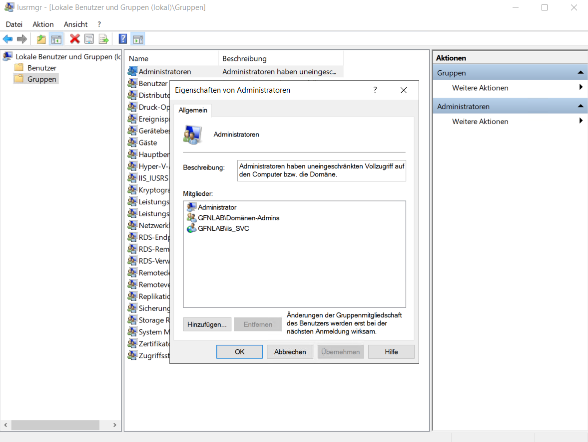
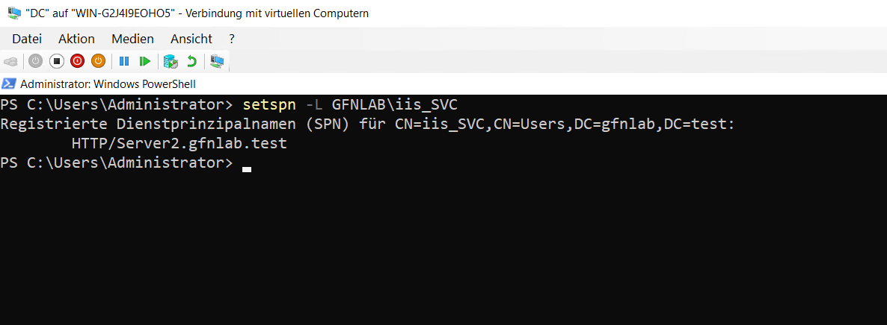
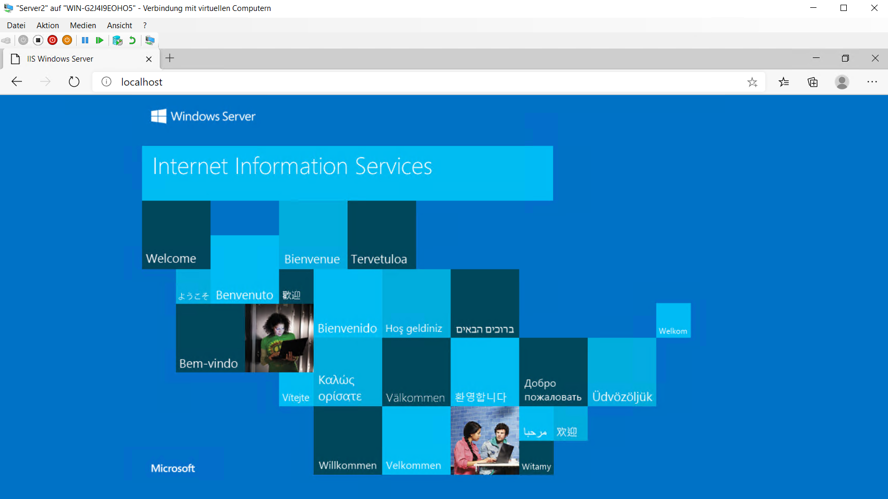

# Dienstkonto und Service Principal Name (SPN)

## Ziel
Ein klassisches Active-Directory-Dienstkonto für IIS auf `Server2` einrichten und einen HTTP-SPN registrieren.

## Umgebung
- Domäne: `gfnlab.test`
- Domänencontroller: `DC`
- Zielserver: `Server2`
- Dienstkonto: `GFNLAB\iis_SVC`

## Durchführung

### 1. Dienstkonto und Gruppe

- In `gfnlab.test/Users` das Benutzerkonto `iis_SVC` erstellt.
- Kennwortänderung bei nächster Anmeldung deaktiviert; Kennwortänderung durch Benutzer untersagt; Kennwortablauf deaktiviert.
- Globale Sicherheitsgruppe `ServiceAccounts` erstellt.
- `iis_SVC` zu `ServiceAccounts` hinzugefügt und diese als primäre Gruppe festgelegt.
- Mitgliedschaft in `Domänen-Benutzer` entfernt.

### 2. Lokale Berechtigung auf Server2

Das Konto `GFNLAB\iis_SVC` der lokalen Gruppe `Administratoren` auf `Server2` hinzugefügt und die Mitgliedschaft in `lusrmgr.msc` geprüft.



### 3. SPN registrieren

Auf `DC`:

```powershell
setspn -S HTTP/Server2.gfnlab.test GFNLAB\iis_SVC
setspn -L GFNLAB\iis_SVC
```

**Ergebnis:** `HTTP/Server2.gfnlab.test` ist dem Dienstkonto `iis_SVC` zugeordnet.



### 4. IIS konfigurieren

- Im IIS-Manager auf `Server2` die Identität von `DefaultAppPool` auf `GFNLAB\iis_SVC` gesetzt.
- Anwendungspool beendet und erneut gestartet.
- `http://localhost` im Browser geöffnet.

**Ergebnis:** Die IIS-Standardseite wurde erfolgreich angezeigt.



## Ergebnis

Das klassische Dienstkonto wurde angelegt, lokal berechtigt und mit einem HTTP-SPN versehen. Die IIS-Standardseite ist auf `Server2` erreichbar. Ein gesonderter Nachweis der Kerberos-Authentifizierung wurde nicht durchgeführt.

> **Sicherheitshinweis:** Die lokale Administratorberechtigung und das nicht ablaufende Kennwort entsprechen dem Laborszenario, nicht einer empfohlenen produktiven Konfiguration.
