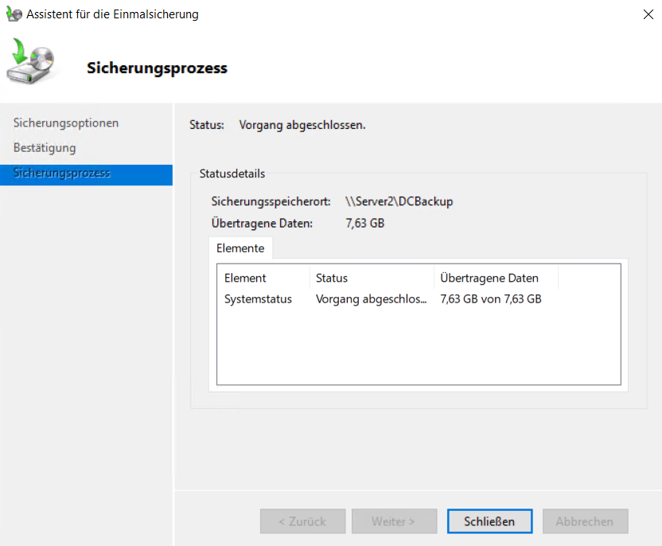

# Systemstatussicherung

## Ziel
Systemstatus von `Server1` sichern und die Sicherung auf `Server2` speichern.

## Umgebung

- Domäne: `gfnlab.test`
- Quellserver: `Server1` (Domänencontroller)
- Sicherungsziel: `\\Server2\DCBackup`

## Durchführung

### 1. Windows Server-Sicherung

Auf `Server1` über **Server-Manager → Rollen und Features hinzufügen** das Feature **Windows Server-Sicherung** installiert.

### 2. Netzwerkfreigabe

Auf `Server2` den Ordner `C:\DCBackup` erstellt und als `DCBackup` freigegeben.

Freigabeberechtigungen:
- `Jeder` entfernt
- `Domänen-Admins`: `Vollzugriff`

### 3. Sicherungszeitplan

Auf `Server1` in **Windows Server-Sicherung → Lokale Sicherung → Sicherungszeitplan** konfiguriert:

- Sicherungskonfiguration: `Benutzerdefiniert`
- Sicherungselement: `Systemstatus`
- Ziel: `\\Server2\DCBackup`
- Anmeldekonto: `GFNLAB\Administrator`

### 4. Einmalsicherung

Über **Einmalsicherung** die Systemstatussicherung ausgeführt.

## Ergebnis

| Merkmal | Ergebnis |
|---|---|
| Sicherungsquelle | `Server1` |
| Sicherungsziel | `\\Server2\DCBackup` |
| Sicherungselement | `Systemstatus` |
| Übertragene Daten | `7,63 GB` |
| Status | `Vorgang abgeschlossen` |

Die Systemstatussicherung wurde abgeschlossen. Eine Wiederherstellung wurde in dieser Aufgabe noch nicht durchgeführt.
