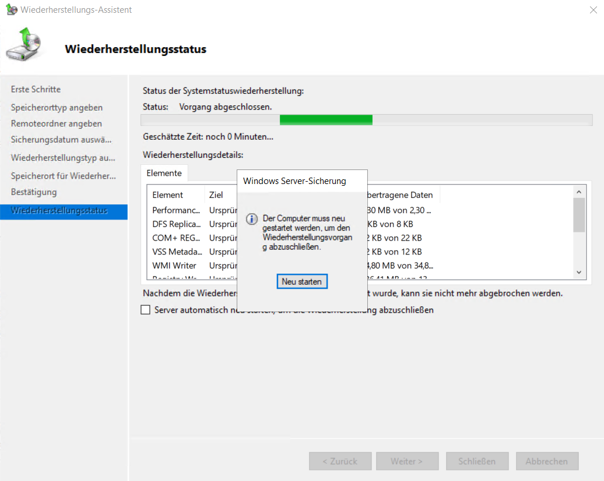

# Systemstatus-Wiederherstellung

## Ziel
Wiederherstellung des Systemstatus von `Server1` aus der Netzwerksicherung auf `Server2`.

## Umgebung

- Domäne: `gfnlab.test`
- Wiederherzustellender Server: `Server1` (Domänencontroller)
- Sicherungsquelle: `\\Server2\DCBackup`
- Sicherungsstand: `27.11.2026, 13:11`

## Durchführung

### 1. Wiederherstellungsmodus

Auf `Server1` den Verzeichnisdienst-Wiederherstellungsmodus (DSRM) aktiviert und neu gestartet:

```powershell
bcdedit /set safeboot dsrepair
Restart-Computer
```

### 2. Sicherung auswählen

In **Windows Server-Sicherung → Lokale Sicherung → Wiederherstellen**:

- **Speicherorttyp:** Freigegebener Remoteordner
- **Pfad:** `\\Server2\DCBackup`
- **Sicherungszeitpunkt:** `27.11.2026, 13:11`
- **Wiederherstellungstyp:** Systemstatus
- **Wiederherstellungsziel:** Ursprünglicher Speicherort
- **Option:** Nicht autorisierende Wiederherstellung

### 3. Systemstatus wiederherstellen

Die Wiederherstellung gestartet und bis zum Abschluss ausgeführt. Windows Server-Sicherung meldete **„Vorgang abgeschlossen“** und forderte einen Neustart an.



### 4. Normalstart wiederherstellen

Nach dem erforderlichen Neustart auf `Server1` die DSRM-Startoption entfernt und erneut gestartet:

```powershell
bcdedit /deletevalue safeboot
Restart-Computer
```

Anschließend Anmeldung mit `GFNLAB\Administrator`.

## Ergebnis

- Systemstatus-Wiederherstellung abgeschlossen.
- `Server1` wieder im normalen Startmodus gestartet.
- Eine anschließende Prüfung der AD-Replikation wurde in dieser Aufgabe nicht durchgeführt.
