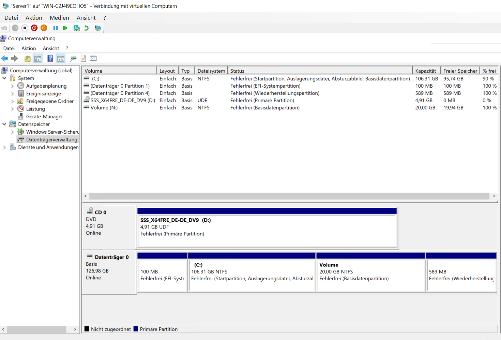
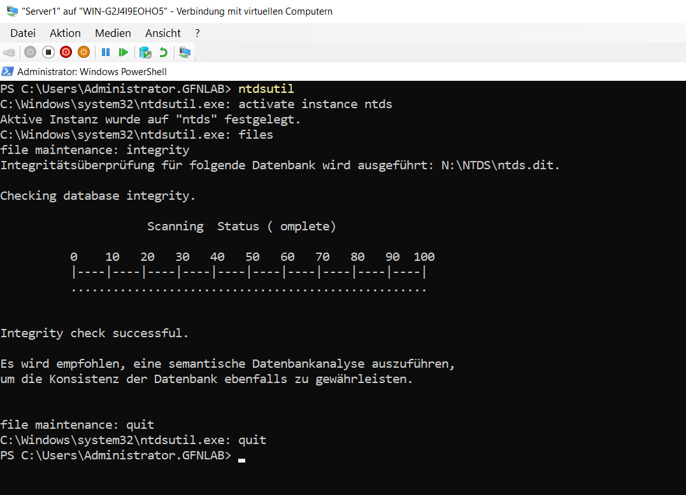

# Active-Directory-Datenbankwartung

## Ziel
Active-Directory-Datenbank und Protokolldateien auf `Server1` verschieben, offline komprimieren und auf Integrität prüfen.

## Umgebung

- Domäne: `gfnlab.test`
- Domänencontroller: `DC`, `Server1`
- Datenbankziel: `N:\NTDS`

## Durchführung

### 1. Partition erstellen

Auf `Server1` das Laufwerk `C:` um `20480 MB` verkleinert und aus dem freien Speicher eine NTFS-Partition `N:` mit `20 GB` erstellt. Anschließend `N:\NTDS` angelegt.



### 2. Datenbank und Protokolle verschieben

Den Dienst `NTDS` einschließlich abhängiger Dienste beendet. Danach mit `ntdsutil` Datenbank und Protokolle verschoben:

```text
activate instance ntds
files
move db to N:\NTDS
move logs to N:\NTDS
quit
quit
```

**Ergebnis:** `ntds.dit` und Protokollverzeichnis lagen unter `N:\NTDS`.

### 3. Offline-Komprimierung

Bei beendetem `NTDS`-Dienst:

```text
activate instance ntds
files
compact to C:\Windows\NTDS
quit
quit
```

**Ergebnis:** `Die Komprimierung war erfolgreich.`

Die ursprüngliche Datenbank als `N:\NTDS\ntds.dit.bak` gesichert und die komprimierte `ntds.dit` nach `N:\NTDS` kopiert. Anschließend die alten Dateien `edb.log`, `edb00002.log` und `edb00003.log` entfernt.

### 4. Integritätsprüfung

```text
activate instance ntds
files
integrity
quit
quit
```

**Ergebnis:** `Integrity check successful.`



### 5. Active Directory und DSRM

- `NTDS` auf `Server1` wieder gestartet; Dienststatus geprüft.
- DSRM-Kennwort für `DC` und `Server1` von `Server1` aus mit `ntdsutil` geändert.

### 6. Laborzustand wiederherstellen

Auf dem Hyper-V-Host alle VMs auf den Prüfpunkt `Basis-AD` zurückgesetzt und ausgeschaltete VMs gestartet.

**Ergebnis:** `DC`, `Server1`, `Server2`, `Server3` und `W11` waren anschließend im Zustand `Running`.

## Ergebnis

- NTDS-Datenbank und LOG-Dateien erfolgreich verschoben.
- Offline-Komprimierung abgeschlossen.
- Datenbankintegrität erfolgreich geprüft.
- `NTDS` vor der Rücksetzung wieder gestartet.
- Laborumgebung auf `Basis-AD` zurückgesetzt.

Die Rücksetzung verwirft die in dieser Übung vorgenommenen Änderungen am aktuellen VM-Zustand.
